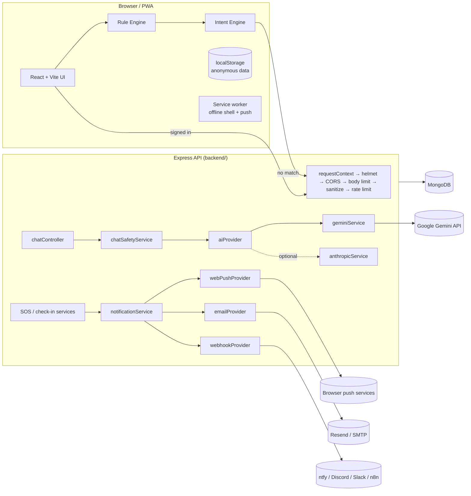
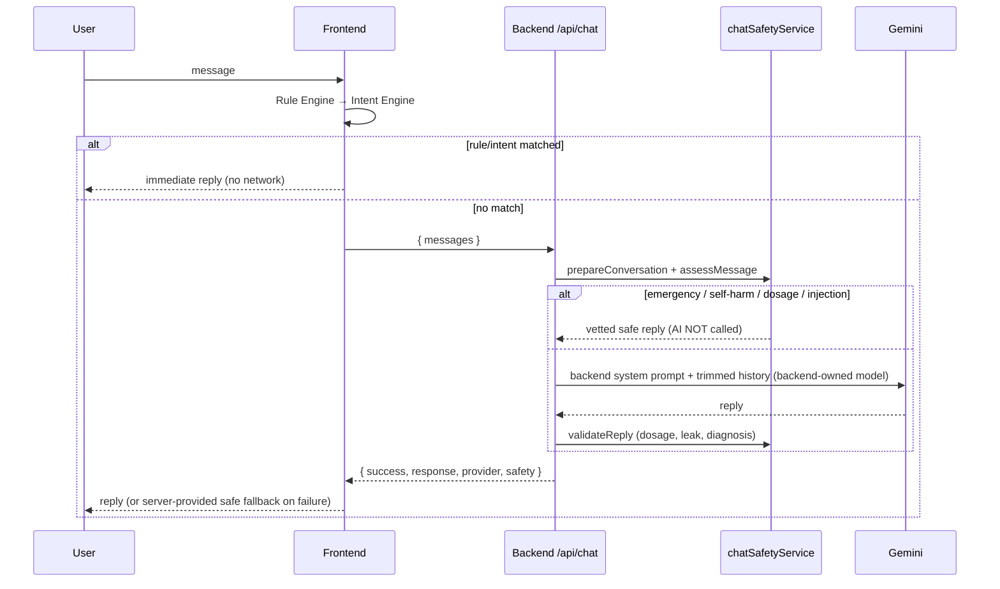

# SakhiAI Architecture

## System overview



## Frontend
- `src/SakhiAI.jsx` – state hub and screen switch (unchanged architecture). Anonymous users read/write **localStorage**; signed-in users additionally sync through `src/services/dataApi.js` ("backend when signed in, localStorage always as the local cache").
- `src/services/apiClient.js` – only HTTP client: base URL from `VITE_API_BASE_URL`, in-memory access token, single-flight refresh, normalised `ApiError`.
- `src/context/AuthContext.jsx` – optional authentication; `pages/AuthPage.jsx` – sign-in/up/forgot/reset, notification-channel status and test alert.
- `src/services/locationService.js` – geolocation with typed errors (`PERMISSION_DENIED`, `TIMEOUT`, …), accuracy classes, coordinate validation.
- Accessible building blocks: `Toast`, `ConfirmDialog`, `Skeleton`, `SOSStatus`, `LocationProblem`.
- PWA: `public/manifest.webmanifest`, `public/sw.js`, `public/offline.html`, `src/services/pwa.js`.

## Backend
`server.js` (process: DB connect, listen, monitor, graceful shutdown) → `app.js` (middleware + routes) → `routes/` → `controllers/` (validation + HTTP) → `services/` (logic) → `models/` (Mongoose).

## Offline-first chat (current)
See [`OFFLINE.md`](OFFLINE.md). The diagram below shows the **server** half; the browser answers from the Rule Engine, Intent Engine and the local knowledge base first and only contacts the server when it cannot answer locally and the connectivity check passes.

## Hybrid chat (server half)



## SOS flow

```mermaid
sequenceDiagram
  participant U as User
  participant F as Frontend
  participant B as Backend
  participant N as notificationService
  U->>F: tap SOS
  F->>F: confirmation + 5 s countdown (cancel anytime)
  F->>F: getPreciseLocation (permission/timeout/accuracy handled; (0,0) rejected)
  F->>U: opens SMS + WhatsApp composers (user must press Send)
  opt signed in
    F->>B: POST /api/sos {lat,lng,accuracy,clientEventId}
    B->>B: create event (location optional)
    B->>N: dispatchAlert(contacts)
    N-->>B: per-attempt SENT / FAILED / NO_RECIPIENT / NOT_CONFIGURED
    B-->>F: event + honest delivery message
    F-->>U: status panel, retry, call 112, "I'm safe"
  end
```

Honest statuses: `SENT` = a provider **accepted** the alert (never "delivered"); `FAILED`; `NOT_CONFIGURED`; `NO_RECIPIENT`; `NO_CONTACTS`; `PENDING`. A contact appears in `contactsNotified` only if a provider accepted an alert for them.

## Adding a notification provider
Create `backend/services/notificationProviders/<name>Provider.js` implementing `{ name, channel, perContact, isConfigured(), canReach?(contact, ctx), send({ contact, alert, userId }) → { status, detail } }` and add it to the `PROVIDERS` array in `notificationService.js`. SOS logic is untouched.

## Offline matrix

| Works offline | Needs internet |
|---|---|
| App shell, cycle/wellness/mood logs (localStorage), Trusted Circle view, rule/intent chat answers, emergency phone numbers (`tel:`), SMS composer on the phone | AI answers, maps & address lookup, sign-in/sync, server SOS alerts, check-in server alerts, push |
