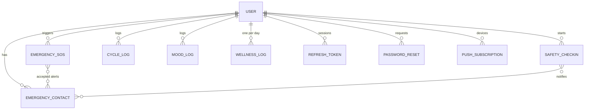

# Database (MongoDB / Mongoose)

| Collection | Key fields / indexes |
|---|---|
| `users` | name, email (unique), password (bcrypt, `select:false`), role, preferences, healthPreferences, lockout fields |
| `emergencycontacts` | user, name, phone (unique per user), email, relation, isPrimary, notifyOn.{sos,checkInMissed} |
| `emergencysos` | user, location (optional) + accuracy/quality, status (`pending/sent/failed/not_configured/cancelled/resolved`), `notifications[]` (per attempt: provider, channel, contact, status, detail), `notificationStatus`, `clientEventId` (unique per user) |
| `safetycheckins` | user, label, deadline, status (`pending/confirmed/missed/cancelled`), startLocation, notifyContacts |
| `cyclelogs` | user, startDate, endDate, cycleLengthDays, flow, symptoms[], notes |
| `moodlogs` | user, mood, intensity, note, loggedDate |
| `wellnesslogs` | user, `date` (YYYY-MM-DD, unique per user), waterGlasses, sleepHours/sleepBucket, activityMinutes, stressLevel, mood, note |
| `refreshtokens` | user, **tokenHash** (SHA-256), family, expiresAt (TTL), revokedAt |
| `passwordresets` | user, **tokenHash**, expiresAt (TTL), usedAt |
| `pushsubscriptions` | user, endpoint (unique), keys |

Data minimisation: no diagnoses or free-form medical history are required; reset/refresh tokens are never stored in clear text.
